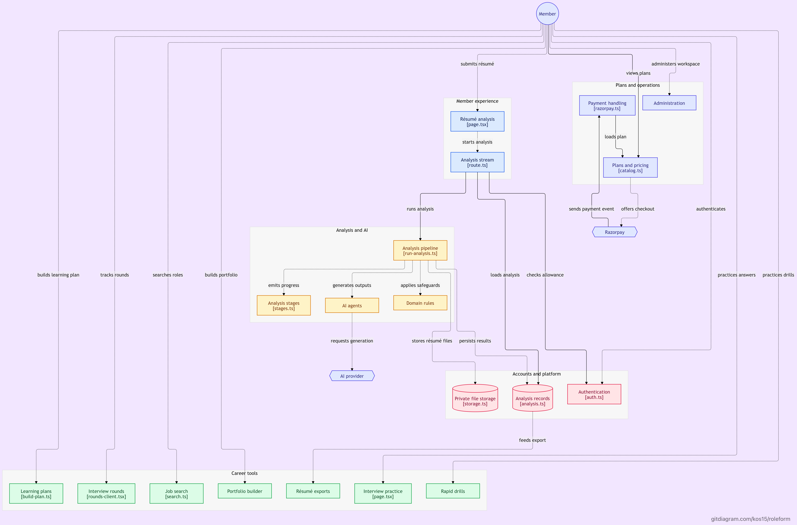
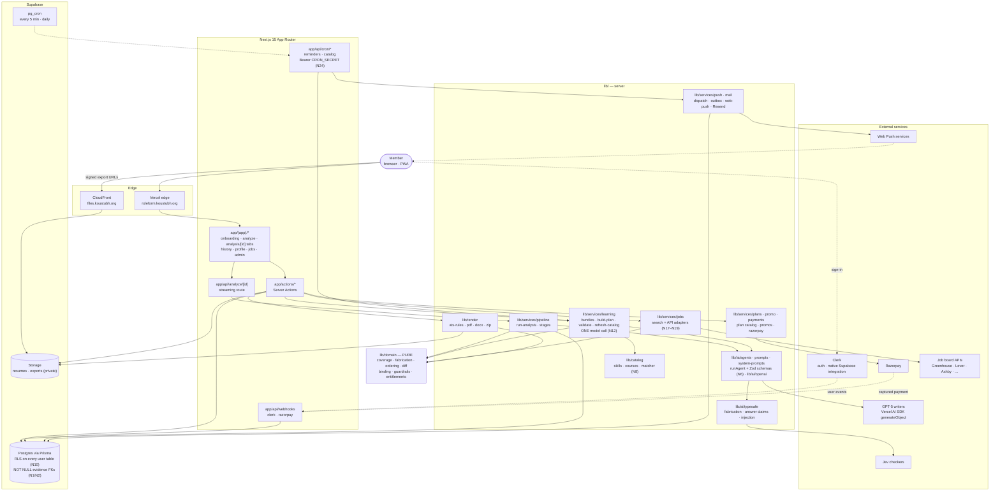

# Roleform

One résumé in, eleven tailored out — plus the questions this posting suggests and the gaps it
exposes. **Nothing is invented**: bullets are reordered, reworded and re-weighted, and every
generated bullet carries a foreign key to the user's own words.

`CLAUDE.md` is the operating contract, `docs/product/specs.md` the architecture,
`docs/product/plan.md` the milestone order, and `PENDING.md` the open work. Read those before
changing behaviour. This file is the runbook. Every change is test-first: `pnpm test`.

---

## Setup

```bash
pnpm install
cp .env.example .env.local     # fill in Clerk, Supabase, OpenAI
```

### Supabase (one project per environment — never point preview at production data)

Two connection strings, both required (`.env.example` documents both): `DATABASE_URL` is the
pooled pgbouncer connection (port 6543) the app runs on; `DIRECT_URL` is a real session
connection (port 5432) that migrations, the two admin scripts, and the deploy-time catalog lock and schedule install need — a transaction-mode
pooler can't provide one.

```bash
pnpm db:generate                # regenerate the Prisma client after any schema.prisma change
pnpm db:migrate:dev --name x    # author a new migration locally (prompts, applies immediately)
pnpm db:migrate                 # apply committed migrations — CI/prod, non-interactive
pnpm db:policies                # apply lib/db/policies.sql — RLS lives in the repo
pnpm seed:catalog               # templates + skills + link-checked course catalog
```

**On Vercel, the build runs these automatically on every deploy** (not `seed:catalog` — `deploy:catalog` syncs the catalog instead, link-checking only new URLs, and `deploy:schedule` installs the pg_cron schedule): `build` is
`prisma migrate deploy && pnpm db:policies && pnpm deploy:catalog && next build --turbopack && pnpm deploy:schedule`,
in that order, against whatever `DATABASE_URL`/`DIRECT_URL` that Vercel environment (production vs.
preview) has configured. Every step is idempotent, so this is safe to run on every build. A failure
in any step fails the build, so a broken migration cannot ship. Local `pnpm db:migrate` / `pnpm db:policies` above
are for authoring and testing a migration before it reaches that pipeline.

Deploy-time sync (N25):

- `pnpm deploy:catalog` and `pnpm deploy:schedule` act only when `VERCEL_ENV=production`; on preview
  and local builds they log one skip line and exit 0.
- The catalog sync runs only when the hash of the seed rows differs from the last `catalog_syncs` row.
- A dead new course URL, or a schedule that cannot be installed, fails the deploy.
- Required production build-time variables: `DATABASE_URL`, `DIRECT_URL`, `APP_URL`, `CRON_SECRET`.
- Promote and Instant Rollback do not rerun the scripts: run `pnpm db:schedule` by hand after either.
- A *Redeploy* (rebuild) of an OLDER commit does rerun them and syncs that commit's older catalog
  back over the newer one (content fields revert; no rows are deleted) until the next normal deploy.
  Prefer Instant Rollback, which does not rebuild.

`prisma/schema.prisma` is the truth; migrations are generated, never hand-authored — except the
two CHECK constraints (N1/N2), which Prisma has no schema syntax for and which are added by
hand, once, to `prisma/migrations/*_init/migration.sql`. Table and column names are
`@@map`/`@map`'d to match `lib/db/policies.sql` exactly, so the RLS file never has to change
when the ORM does.

Create both storage buckets as **private**: `resumes`, `exports`. `db:policies` writes their
path-prefix policies; the buckets themselves are created in the dashboard once.

### Clerk ↔ Supabase

Use the **native third-party integration**, not the deprecated JWT-template path:

1. Clerk dashboard → **Integrations → Supabase** → connect, copy the Clerk domain.
2. Supabase dashboard → **Authentication → Third-party auth** → add that Clerk domain.
3. Confirm the session token carries `"role": "authenticated"`.

`auth.uid()` is not used anywhere — it returns a UUID and Clerk subjects are strings. Every
policy reads `public.clerk_user_id()` instead.

Webhook: point Clerk at `POST /api/webhooks/clerk` (events `user.created`, `user.updated`,
`user.deleted`) and set `CLERK_WEBHOOK_SIGNING_SECRET`.

---

## Verification

Light by design (CLAUDE.md §11): no continuous suite, no CI gating. One manual checklist per
milestone, at the gate. These are the commands behind it.

| Command | What it is | When |
|---|---|---|
| `pnpm check:constraints` | ★ Constraint smoke test — one bad insert per guard (N1, N2, RLS) | M1 gate, once |
| `pnpm check:fabrication` | ★ Fabrication eval — 30 bullets vs postings demanding absent skills | M4 gate |
| `pnpm check:roundtrip` | ★ DOCX round-trip — render, re-import, compare (bar: 95%) | M6 gate |
| `pnpm test` | Every pure check (score, pre-strip, agents, quotas, lanes, push, jobs…) plus repo-shape rules. No DB, no keys | before every commit |
| `pnpm check:drill` | Runs every DSA bank solution against its own tests — JavaScript in the QuickJS sandbox, Python via local `python3` (F26). No DB, no keys | whenever the bank changes |
| `pnpm render:samples` | Renders all eleven templates to `.samples/`. Open them | anytime |
| `pnpm check:links` | Catalog link check, refreshes `verified_at` | manual full sweep (the daily cron re-checks due rows) |
| `pnpm tokens:calibrate` | Measured p50/p95 tokens per purpose, for hand-recalibrating `TOKEN_STAGES` (F24) | after a prompt change, or quarterly |

The three ★ checks are the ones that survive the light-testing policy, because each catches a
failure that would otherwise be expensive and silent.

`check:fabrication` needs `EVAL_ANALYSIS_ID` set to a real analysis you own — it writes
`ai_runs` rows like any other call. Its automated verdict catches mechanical fabrication;
**read all 30 outputs by hand**, because no regex sees "led" where the source said
"contributed to".

### Current state of the checks

```
pnpm test (coverage)  PASS   all fixtures, including the hand-computed 61.11
pnpm check:roundtrip   PASS   100% field recovery on all eleven templates
pnpm render:samples    PASS   PDFs render in 34–123 ms, full text layer, ATS High/High/Medium/Medium/Low/Low
pnpm build             PASS   clean; service-role client and DB adapter absent from every client chunk
pnpm check:constraints PASS   4/4 guards, against the live Supabase project — N1, N2, N10 all confirmed
pnpm seed:catalog      PASS   123/129 courses seeded; 6 flagged unreachable (bot-blocking false
                              positives on Kaggle/Cloudflare/etc — re-check with pnpm check:links)
pnpm check:fabrication PASS   0/30 mechanical fabrications, live against OpenAI (gpt-4.1)
```

---

## Architecture in one screen

### System overview

What a member touches and where each request lands
(generated with [gitdiagram](https://gitdiagram.com/kos15/roleform)):



### Layers and trust boundaries

The same system drawn by layer. Solid arrows are request-time calls; dotted arrows are
scheduled or webhook-driven. Nothing in `lib/domain/` talks to I/O, and the model only ever
reaches the database through a Zod schema and the pipeline that validates it.



### Code map

```
lib/domain/      PURE. coverage · scoring · ordering · diff · fabrication guard
                 Imports nothing from db, ai, supabase or next.
lib/ai/          generateObject + Zod only. schemas/ IS the contract; prompts/ are docs.
lib/catalog/     skills canon + alias table · curated courses · deterministic matcher
lib/render/      ats-rules (the badge) · pdf/ · docx/ · zip · shared render model
lib/db/          index.ts (Prisma client) · policies.sql · queries/ (all scoped by subject)
prisma/          schema.prisma is the truth · migrations/ (in-repo, generated)
lib/services/pipeline/    the five stages, with per-tab degradation
app/actions/     Server Actions · app/api/ streaming + webhooks only
```

**Four layers stand between the model and a fabricated claim**, in order of how hard they are
to talk around:

1. a narrow Zod schema (N6)
2. id verification against the input set, with one corrective retry
3. `lib/domain/fabrication.ts` — pure, then verbatim fallback
4. `tailored_bullets.source_bullet_id` `NOT NULL` `ON DELETE RESTRICT` (N1)

Only the fourth cannot be argued with. That is why it exists.

---

## What is deliberately not here

- **No job queue.** Inline + streaming until "Download all" exceeds the function budget or p95
  analysis passes 45s. `exportAll` logs its elapsed time so the trigger is measurable, not felt.
- **No vector DB.** The corpus is one user's résumé; there is no retrieval problem.
- **No LLM in coverage, scoring, ATS rating or course matching.** All four are deterministic
  and reproducible from identical inputs. The score is the number a user makes a decision on.
- **No "ATS score".** The match number is requirement coverage. The word "ATS" appears only on
  a template badge, computed from structural rules.
